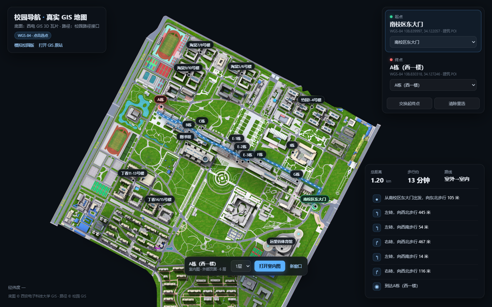
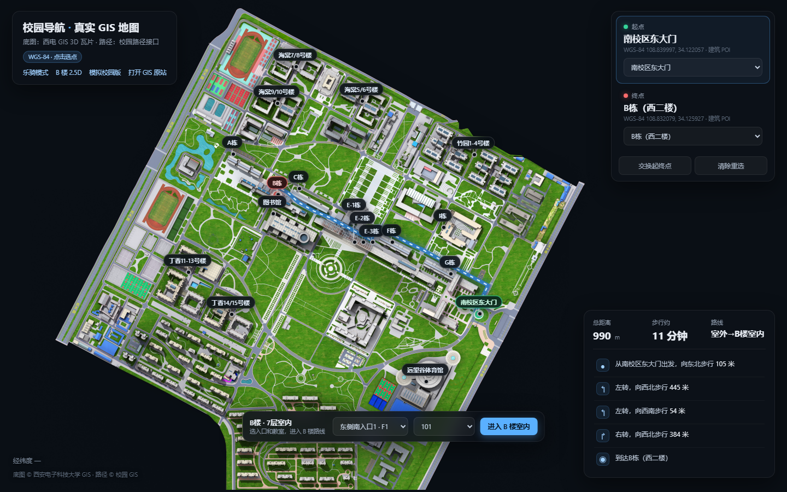

# 西电校园导航 · Campus Nav

西安电子科技大学南校区校园导航演示：**真实 GIS 底图 + 室外步行路线 + B 楼 2.5D 室内导航 + 乐骑模式**。

> 主入口：`real-map.html`（真实 GIS 版）  
> 在线演示：部署 GitHub Pages 后访问 `https://<你的用户名>.github.io/campus-nav/real-map.html`



## 功能

- **真实 GIS 室外地图**：Leaflet + 西电 GIS 瓦片，支持点击道路/建筑选起点终点、任意点道路吸附、步行路线与中文分步指引。
- **B 楼 2.5D 室内导航**：本地模型 v4.1，9 个楼层块（F1–F7 + N4/N5）、80 间教室、265 个节点、318 条边、8 个入口；入口 → 教室 Dijkstra 算路，支持跨层楼梯/电梯与分步指引。
- **外部室内页对接**：A / C / E-1 / E-2 / E-3 / F / G / I 栋深链到 `campus-map-site` 新版室内图，支持房间热点、房间搜索、本层房间列表。
- **乐骑模式**：独立页面，路线 ≥3 km、经过南/北操场、优先大路、无重复节点/自交/绕圈，14 km/h 估算。
- **零构建**：纯静态 HTML/CSS/JS，`file://` 或任意静态服务器均可运行（推荐用本地服务器，避免浏览器限制 `fetch`）。



## 快速开始

在仓库根目录启动任意静态服务器：

```powershell
# Python 3
python -m http.server 8765

# 或 Node
npx serve .
```

然后打开：

- 真实 GIS 地图：<http://127.0.0.1:8765/real-map.html>
- 模拟室外地图：<http://127.0.0.1:8765/index.html>
- 乐骑模式：<http://127.0.0.1:8765/cycling.html>
- B 楼 3D 室内：<http://127.0.0.1:8765/b-package/3d.html>

示例路线：<http://127.0.0.1:8765/real-map.html?from=GATE&to=A&floor=2F>

> 真实 GIS 底图与路径接口来自学校 GIS 服务，外部室内页来自 `campus-map-site`，均需要联网。B 楼模型完全本地。

## 目录

```text
.
├─ index.html                 # 模拟室外地图
├─ real-map.html              # 真实 GIS 地图（主入口）
├─ cycling.html               # 乐骑模式
├─ app/                       # 页面逻辑（室外 / 乐骑 / 桥接）
├─ data/                      # 校园数据、POI、乐骑路网、道路吸附点
├─ styles/                    # 页面样式
├─ vendor/                    # Leaflet
├─ assets/indoor-providers.js # 外部室内页配置与深链
├─ b-package/                 # B 楼本地 2.5D 模型与室内导航
├─ tests/                     # Node 测试（无需浏览器）
├─ tools/                     # 数据生成与提供方校验脚本
├─ docs/                      # B 楼数据审计等文档
└─ screenshots/               # README 截图
```

## 测试

```powershell
node tests/run.js
node tests/real-map.test.js
node tests/b-package.test.js
node tests/cycling.test.js
node tests/bridge-sim.js
```

真实 GIS 测试会访问学校接口；网络不可用时相关断言会 SKIP，不会伪造 PASS。

## 数据与接口

- 底图瓦片：`https://gis.xidian.edu.cn/map?lyrs=zst&x={x}&y={y}&z={z}`
- 步行路线：`https://gis.xidian.edu.cn/openmap/mapi/direction/v2?origin=<lon>,<lat>&destination=<lon>,<lat>&mode=walk`
- 乐骑路网：OpenStreetMap 数据，GCJ-02 坐标，页面内保留 OSM 署名。
- 外部室内页：<https://yang112400.github.io/campus-map-site/>
- B 楼模型：`b-package/assets/b-building-data.js`（b-model-kit v4.1）

## 已知限制

- 真实 GIS 版与模拟版的坐标口径不同；5 m 精度只对模拟版室外米制场景成立。
- 外部室内页是独立图纸，只能直达「楼栋 + 楼层」，没有房间级深链；进入后用站内搜索/热点定位。
- B 楼 2.5D 模型为示意模型，坐标、入口和路线时间均为估算。
- 学校 GIS 接口可能限流或变更；页面已做超时、重试与错误分类，但无法保证长期可用。

## License

[MIT](LICENSE)
